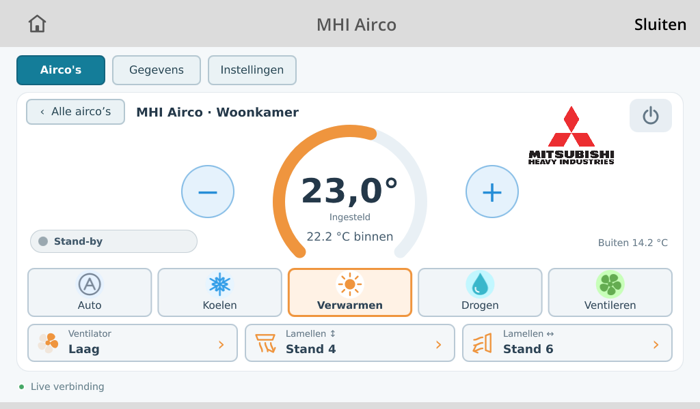
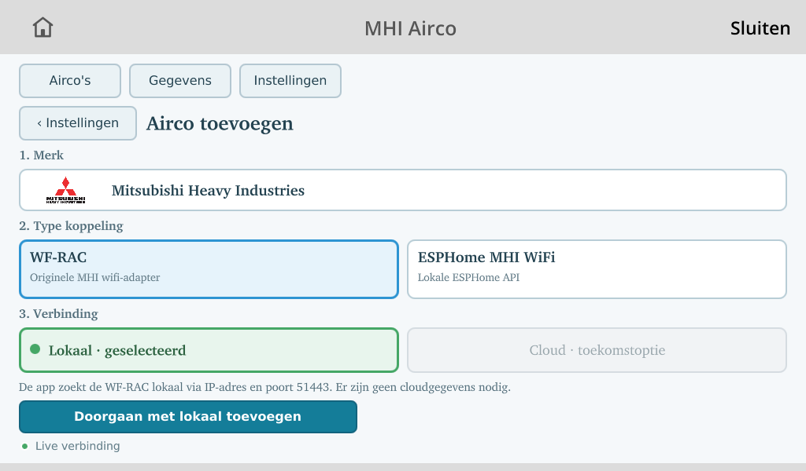
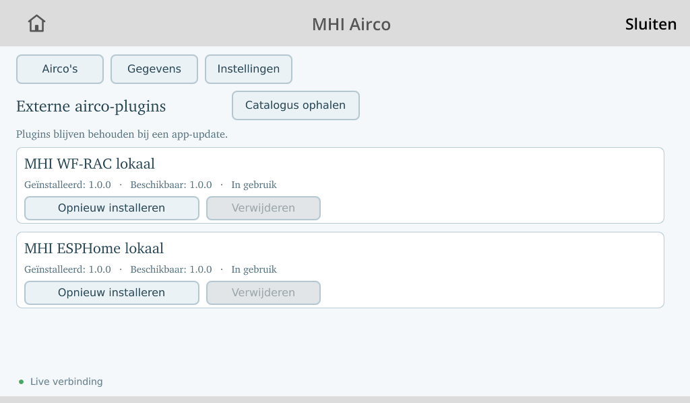

# MHI Airco voor Toon 2

Native Toon-app voor de lokale bediening van een of meer Mitsubishi Heavy
Industries-airco's. De app gebruikt losse connectorplugins voor:

- Mitsubishi WF-RAC via het lokale netwerk;
- ESPHome MHI via de versleutelde native API.

## Functies

- overzicht en bediening per airco;
- temperatuur, modus, ventilator en lamellen;
- compacte liveweergave zonder meetlog;
- behoud van de laatst bekende sensorwaarden bij een korte verbindingsfout;
- optionele blokkering van koelen per airco zolang Toon CV-warmtevraag meldt;
- vaste Toon-tegels die bij een app-update behouden blijven;
- automatische detectie en handmatig toevoegen, aanpassen en verwijderen.

De connectorplugins en catalogus staan in
[`phoenix-blue/toon-mhi-plugins`](https://github.com/phoenix-blue/toon-mhi-plugins).

## Installatie via TSC DEV

Versie `0.2.1` is voorbereid voor de DEV-catalogus van de Toon Software
Collective. Na opname in DEV kan de app via ToonStore worden geïnstalleerd.
De gewenste connector wordt daarna vanuit **Instellingen > Plugins** gekozen.

De configuratie staat op Toon in `/mnt/data/tsc/mhi.json`. Updates vervangen
dit bestand en afzonderlijk opgeslagen ESPHome API-sleutels niet.

## Schermafbeeldingen

### Bediening

### Airco toevoegen

### Pluginbeheer

## Privacy

De app houdt geen historische meetlog bij. Het repository bevat geen
persoonlijke IP-adressen, apparaat-ID's, accounts of API-sleutels.

## Status

Dit is een DEV-release voor Toon 2. Test WF-RAC en ESPHome na installatie eerst
per airco voordat de bediening als productie-kritisch wordt gebruikt.
